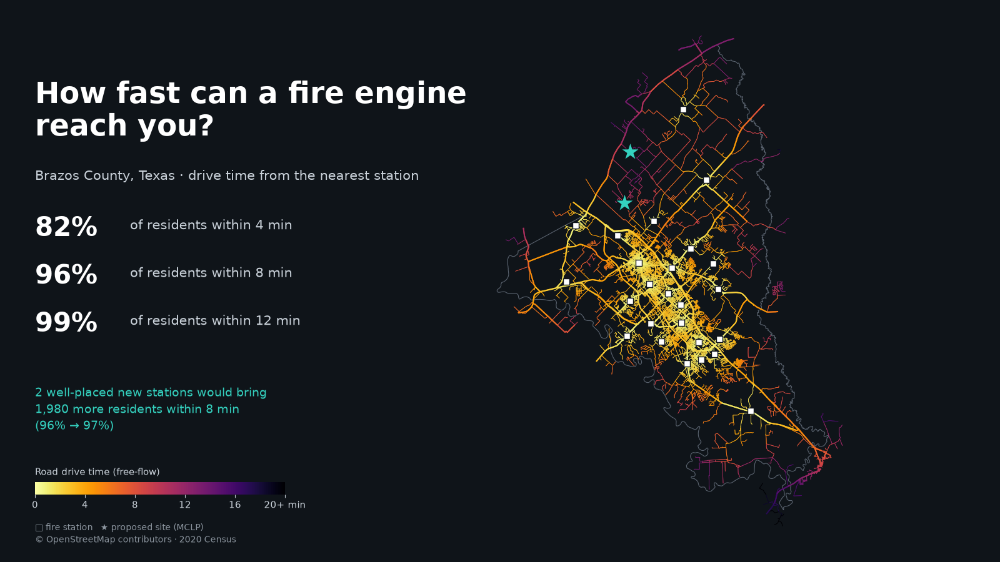
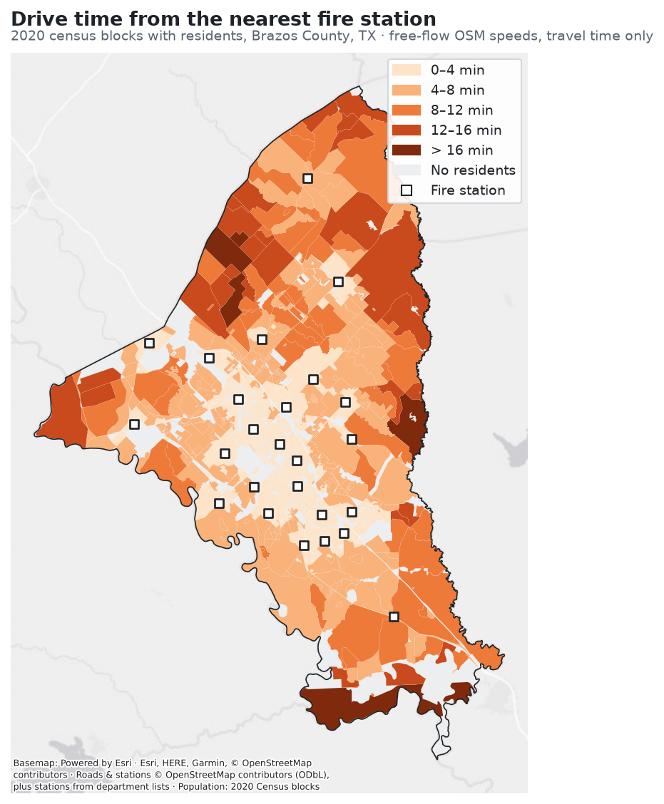
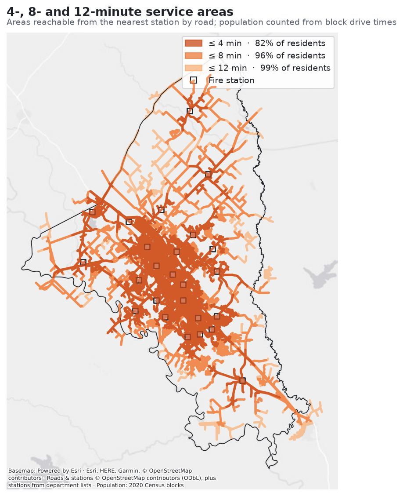
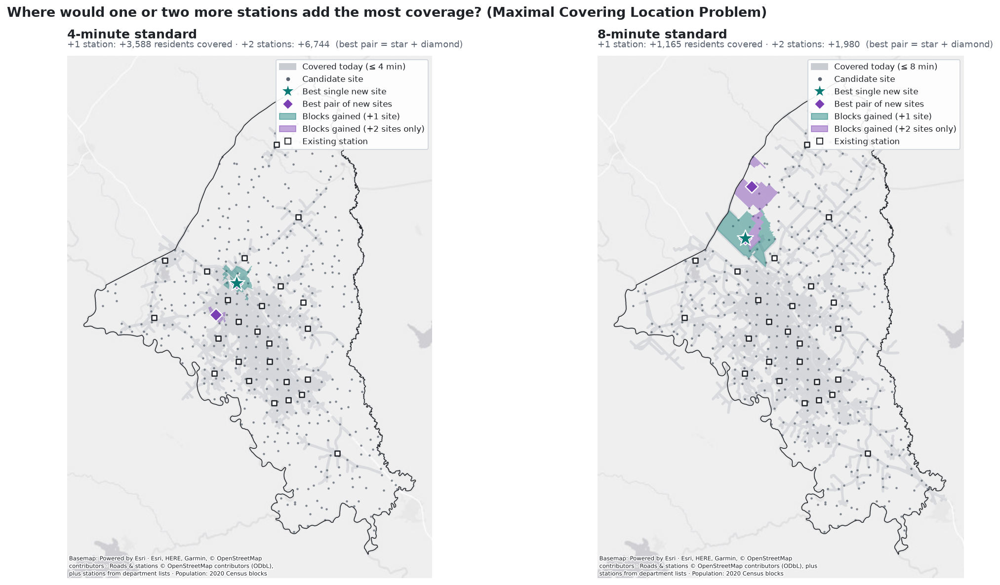
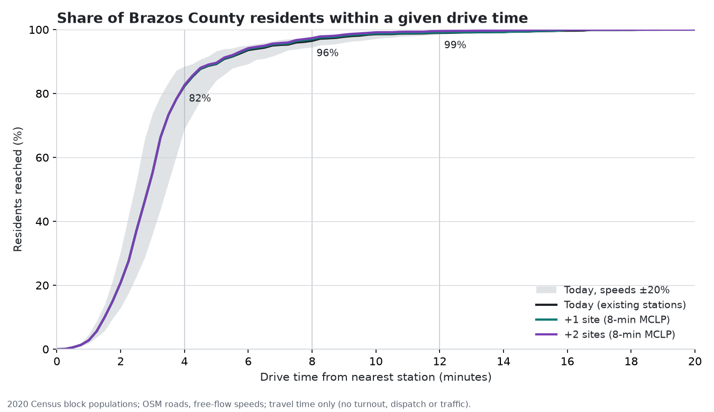

# Brazos Fire Access

**How fast can a fire engine reach you in Brazos County, Texas, and where would one more station help most?** This project measures the road drive time from the nearest fire station to every populated 2020 census block, maps 4-, 8- and 12-minute service areas, and uses location-allocation (Maximal Covering Location Problem and p-median) to find where one or two additional stations would reach the most residents.

## Summary

- **Question:** How long is the road drive from the nearest fire station to each populated block in Brazos County, and where would one or two new stations add the most coverage?
- **Answer:** With 25 stations, 82.3 % of the 233,849 residents are within 4 minutes and 96.5 % within 8 minutes. Two new stations at the edges of Bryan would raise 4-minute coverage to 85.2 % (+6,744 residents).
- **Main limitation:** This is modelled travel time on free-flow speeds, not response time, and the 4-minute share ranges from 69.0 % to 88.5 % when road speeds change by ±20 %.



> This is a planning exercise with open data, not an assessment of any fire department. It measures **travel time only** on free-flow road speeds; it knows nothing about staffing, apparatus, call volume, mutual aid or real response performance.

## My role

I'm a geographer: B.S. in Geography with a GIS background, now an M.S. Geography student at Texas A&M. I ran this project as the human on the loop. I owned the question, the standards and every decision about what gets published, and used Claude Code (Anthropic) as the programmer.

- **Problem framing:** I defined the question, approved the study area and data, and set what a useful, defensible answer looks like.
- **Standards:** spatially held-out validation where the data allow, methods grounded in peer-reviewed literature, honest uncertainty (intervals and stated limitations), and a stated cost for every design choice.
- **Oversight at every stage:** I reviewed the plan, the intermediate results, the figures and the write-up, challenged anything unclear or unsupported, and sent work back until it met the standard.
- **Quality control:** before publishing, every number was traced to the project's results, the references checked and the tests run. The final call on what is reported, and what is stated as a limitation, is mine.

Commits made with Claude Code carry its `Co-Authored-By` line.

## Key results

Brazos County, 2020 Census population **233,849** in 2,523 populated blocks; **25 fire stations**: 16 mapped in OpenStreetMap plus 9 that OSM is missing, added from department-reported station lists (see [Fire stations](#fire-stations)). Unless noted, all numbers come from [`results/metrics.json`](results/metrics.json); the OSM-only case below comes from `python run.py --no-supplement`.

| Drive time from the nearest station | Residents | Share |
|---|---|---|
| ≤ 4 min | 192,446 | **82.3 %** |
| ≤ 8 min | 225,626 | **96.5 %** |
| ≤ 12 min | 231,467 | **99.0 %** |

Population-weighted drive time: mean **3.20 min**, median 2.83 min, 90th percentile 5.10 min; the farthest populated block is 18.9 min away. Coverage is high because Bryan and College Station hold most residents and most of the stations, and the county's volunteer departments have stations spread through the rural precincts; the remaining gaps are sparsely populated rural blocks in the north-west, along the eastern county line and in the far south.

**Where would new stations add the most coverage?** (MCLP, existing stations kept; 430 candidate sites)

| Standard | +1 station | +2 stations | Coverage after +2 |
|---|---|---|---|
| 4 min | +3,588 residents (+1.5 pts), north Bryan near US 190 | +6,744 (+2.9 pts): the same site plus west Bryan near Beck Street | 82.3 % → 85.2 % |
| 8 min | +1,165 residents (+0.5 pts), north-west of Bryan on FM 2223 | +1,980 (+0.8 pts): the same site plus a site farther north, about 2 km from TX OSR | 96.5 % → 97.3 % |

- Both MCLP answers were solved to proven optimality with HiGHS and match an exhaustive search over every single site and every pair of sites.
- The two standards point to different places. A **4-minute** standard favours infill at the edges of Bryan, where many people live 4–6 minutes from a station; an **8-minute** standard favours the rural north-west, where fewer people live but nobody is close to a station. The 8-minute gains are small (under 1 point): with all 25 stations, almost everyone is already within 8 minutes.
- **p-median** (minimise the population-weighted mean drive time) picks central Bryan near TX 308 for one site and adds a College Station site near Holleman Drive for two, lowering the mean from 3.20 to 3.10 and 3.01 minutes. Averages reward serving many people a little faster; coverage rewards bringing people under a threshold, so the methods disagree by design.
- **Why the station list matters.** With only the 16 OSM stations, coverage is 78.6 % / 94.6 % / 98.0 %, and its best 8-minute pair fell 160 m and 210 m from two Precinct 3 volunteer stations that OSM does not map: the optimiser was rediscovering stations that already exist. `python run.py --no-supplement` reproduces that OSM-only case.

**Sensitivity to road speeds (±20 %).**

| Speeds | ≤ 4 min | ≤ 8 min | ≤ 12 min | Best +2 sites gain, 4 min | Best +2 sites gain, 8 min |
|---|---|---|---|---|---|
| 20 % slower | 69.0 % | 94.5 % | 98.6 % | +11,242 | +2,234 |
| as imputed | 82.3 % | 96.5 % | 99.0 % | +6,744 | +1,980 |
| 20 % faster | 88.5 % | 97.8 % | 99.3 % | +3,954 | +1,855 |

The 4-minute share is the fragile number: it moves 13.3 points down or 6.2 up with speed, because much of the urban population sits 3–5 minutes from a station. The 8- and 12-minute shares barely move. The chosen sites are only partly stable: under ±20 % speeds the sites of the best 4-minute pair move 4–12 km, and those of the 8-minute pair move 3.5–29 km, because the 8-minute gains are small and several fringe locations score almost the same. Treat the sites as **areas worth a closer look**, not addresses.

| Drive time by block | 4/8/12-minute service areas |
|---|---|
|  |  |





An interactive map with layer toggles for stations, service areas and proposed sites is in [`docs/map.html`](docs/map.html) (works as a GitHub Pages page).

### Benchmarks, read carefully

The 4-minute line comes from **NFPA 1710** (2020 edition, for career fire departments), which sets **240 seconds of travel time** for the arrival of the first engine company at a fire suppression incident, to be met for 90 % of incidents. **NFPA 1720** (2020 edition) covers volunteer and combination departments and uses longer, staffing-based *response-time* objectives that vary with population density (urban, suburban, rural and remote demand zones). Under NFPA's Emergency Response and Responder Safety Document Consolidation Plan, both have since been combined, with NFPA 1730 and NFPA 1201, into **NFPA 1750**, *Standard for the Organization and Deployment of Fire Suppression Operations, Emergency Medical Services, Special Operations, and Fire Prevention Activities* (2026 edition, issued 19 November 2025, effective 9 December 2025); the 2020 editions are the last stand-alone versions. The 240-second wording is cited from NFPA 1710 (2020); how NFPA 1750 states it was not checked here. Brazos County is served by both career and volunteer departments. The numbers here are modelled travel times from a station to a block, not incident data, so they cannot say whether any department meets either standard; the 4-minute line is used as a familiar planning yardstick only.

## Decisions

- **I added 9 stations that OpenStreetMap is missing, taken from department lists.** With OSM alone, the best 8-minute pair fell 160 m and 210 m from two real stations, so the optimiser was rediscovering stations that exist. The cost is a hand-built list with approximate geocoded positions (about 100-300 m). `--no-supplement` keeps the OSM-only case reproducible.
- **I ran two objectives and reported where they disagree.** The Maximal Covering Location Problem (MCLP) counts people brought under a time threshold. The p-median lowers the average drive time. Averages reward serving many people a little faster, while coverage rewards bringing people under a threshold, so the two pick different sites.
- **I confirmed the solver's answers by checking every single site and every pair.** With 1-2 new sites the number of combinations is small enough to try them all; for larger *p* only the solver is used.
- **I re-ran everything with road speeds 20 % slower and faster instead of reporting one number.** The chosen sites moved 3.5-29 km for the 8-minute pair, so I present them as areas worth a closer look, not addresses.
- **I kept only the largest strongly connected part of the road network.** Every node can then reach and be reached by car under one-way rules. This drops 136 of 10,958 nodes (about 191 km of road).

## Method

1. **Population.** 2020 TIGER/Line tabulation blocks for Texas (`tl_2020_48_tabblock20.zip`, Census Bureau), filtered to Brazos County (COUNTYFP 041); `POP20` is the 2020 decennial (P.L. 94-171) count. Each populated block is represented by its Census internal point. The county outline is the union of its blocks.
2. **Roads.** OpenStreetMap drive network from OSMnx (Boeing 2017) for the county plus a 2 km buffer, so roads that leave and re-enter the county are kept. Speeds use OSMnx imputation: tagged `maxspeed` where present (29 % of edges), otherwise the mean tagged speed of the same highway type (for example residential ≈ 47 km/h, primary ≈ 75 km/h, motorway ≈ 114 km/h), with 48 km/h (30 mph) for any type with no tags at all. Travel time = length / speed. No traffic, signals or turn penalties.
3. **Connectivity.** The network is reduced to its largest strongly connected component, so every node can reach and be reached from every other in one-way-aware driving: 10,822 of 10,958 nodes kept (136 dropped, about 191 km of 6,270 km of road: small pieces that cannot be both entered and left by car under the one-way tags).
4. **Snapping.** Each station is attached to the nearest road **edge**, not the nearest node: a new node is inserted at the closest point on that edge and the edge is split there, with length and travel time divided in proportion, in both directions for two-way roads. The remaining gap from the station point to the road (median 33 m, at most 174 m) is timed at 30 km/h as a head start before the engine reaches the road. Because the nearest edge to a building or geocoded point is sometimes a side street rather than the road the bays open onto, a few stations may start on a slightly slower street than in reality. Blocks snap to the nearest network node; a block's time adds the straight-line hop from its internal point to that node at 20 km/h (median hop 83 m; 95th percentile 614 m, in large rural blocks).
5. **Drive times.** One multi-source Dijkstra on the directed graph from all stations at once gives every node its time from the nearest station (`scipy.sparse.csgraph.dijkstra`, `min_only=True`), so travel runs in the direction an engine drives.
6. **Service areas.** Edges reachable within 4, 8 and 12 minutes are kept, partial edges are cut at the point reached (like a trimmed Network Analyst service area), and the lines are buffered by 200 m and dissolved. The polygons are for display; all population counts come from block drive times.
7. **Candidate sites.** A 1.6 km grid over the county; in each cell, the network node nearest the cell centre that touches a surface street (not only a freeway or ramp), excluding nodes that already host a station. 430 candidates. A candidate-to-block drive-time matrix comes from one Dijkstra per candidate.
8. **Maximal Covering Location Problem** (Church & ReVelle 1974): maximise the population newly brought within the standard by *p* new sites, with existing stations kept open; binary site variables, solved with PuLP and HiGHS for *p* = 1, 2 and standards of 4 and 8 minutes. Because *p* is small, the same optimum is confirmed by exhaustive enumeration.
9. **p-median** (Hakimi 1964): minimise population-weighted mean drive time with existing stations fixed; exact by enumeration for *p* = 1, 2.
10. **Sensitivity.** Every road speed scaled by 0.8 and 1.2; drive times, coverage and MCLP solutions recomputed.
11. **Validation.** For the 909 blocks more than 2 km in a straight line from their nearest station, the implied straight-line speed has a median of 42 km/h (5th–95th percentile 27–61 km/h), plausible for a mix of city streets and highways, and no block is reached faster than the fastest road allows. Spot checks: 2.1 km in 3.5 min, 2.8 km in 6.1 min, 5.0 km in 7.5 min.

### Fire stations

OpenStreetMap has 16 `amenity=fire_station` features inside the county (no duplicates within 150 m). Each one corresponds to a station on a department list, and the 13 whose published addresses match in the Census Geocoder sit within 250 m of that address (median 70 m). But OSM is **missing 9 of the 25 stations** the departments list, almost all of them rural volunteer stations. Those 9 are added from [`data_sources/stations_supplement.csv`](data_sources/stations_supplement.csv), which gives each station's published address, its source URL, and coordinates from the [U.S. Census Geocoder](https://geocoding.geo.census.gov/) (address-range interpolation along the street, so positions are approximate, roughly 100–300 m).

| Department | Stations used | In OSM | Added from the department list | Source |
|---|---|---|---|---|
| Bryan Fire Department | 1–5 | 5 | none | [NERIS](https://neris.fsri.org/departments/FD48041954/stations) |
| College Station Fire Department | 1–7 | 6 | Station 7 (Greens Prairie Rd W; ribbon-cutting announced Sept 2026) | [City of College Station](https://www.cstx.gov/departments___city_hall/fire/fire_stations___facilities), [Station 7](https://www.cstx.gov/news/posts/fire-station-no-7-ribbon-cutting-ceremony-set-for-friday/) |
| Brazos County VFD District 2 (Kurten, Edge, Wixon Valley) | 1–3 | 1 | Stations 2 (FM 974) and 3 (Dilly Shaw Tap Rd) | [NERIS](https://neris.fsri.org/departments/FD48041335/stations) |
| Brazos County Precinct 3 VFD | 1–3 | 0 | Stations 1 (Mesco Dr), 2 (Elmo Weedon Rd), 3 (Roans Chapel Rd) | [NERIS](https://neris.fsri.org/departments/FD48041743/stations) |
| Brazos County Precinct 4 VFD | 1–3 | 2 (Station 1 unnamed in OSM; Station 3 tagged "Brushy Station") | Station 2 (Old San Antonio Rd) | [NERIS](https://neris.fsri.org/departments/FD48041355/stations) |
| South Brazos County FD (Brazos County ESD No. 1) | 1, 2, 3, 6 | 2 | Stations 3 (Arrington Rd) and 6 (Walnut Rd) | [ESD 1 stations page](https://brazoscountyesd1.org/stations-and-apparatus) |

Notes. The rural volunteer departments do not appear to publish station rosters on their own websites, so their lists come from department-reported records in NERIS, the national fire information system run by UL's Fire Safety Research Institute with the U.S. Fire Administration (NERIS repeats some stations under two names; duplicates were removed by address). South Brazos County's Station 4 (20665 SH 6 S) is listed on the ESD 1 page but **not used**: a new Station 4 on SH 6 broke ground in July 2026 for completion in 2027, a July 2026 news report counts four existing district stations, and the address did not geocode. Texas A&M University has no fire department of its own; College Station FD serves the campus. Planned stations (for example Bryan's unfunded future Station 6) and stations in neighbouring counties that may answer calls near the line are not included. Two OSM name typos are corrected for display only. Station lists change; the CSV is the one place to correct them.

## How to run

```bash
conda env create -f environment.yml
conda activate gis-portfolio
python run.py                              # Brazos County (48041), 4/8-min standards, 1-2 new stations
python run.py --standards 4 6 8 --new 3    # other standards; up to 3 new stations (MCLP)
python run.py --speed-factor 0.85          # all roads 15 % slower than the imputed speeds
python run.py --county 157 --no-basemap    # another Texas county (Fort Bend)
pytest -q                                  # fast offline tests
```

The first run downloads the Texas block file (≈750 MB, kept in `data/raw/`) and the OSM network through the public Overpass API. In this run the network download took about 16 minutes because the public Overpass servers were busy (the code retries other endpoints). Everything is cached in `data/` (git-ignored), and later runs take about 20 seconds. Exhaustive checks and the p-median are run only for 1–2 new sites.

```
fireaccess/network.py   OSM download, speed imputation, strong connectivity, edge splitting, sparse travel-time graph
fireaccess/demand.py    census blocks, OSM fire stations + documented supplement, snapping
fireaccess/coverage.py  multi-source Dijkstra, coverage counts and curve, isochrones, candidate grid
fireaccess/optimize.py  MCLP (PuLP + HiGHS), exact small-p enumeration, p-median
fireaccess/maps.py      figures, hero image, folium map
run.py                  pipeline entry point (argparse)
tests/                  toy graphs, edge splitting, MCLP with a known optimum, isochrone trimming, coverage counting, station supplement
data_sources/           stations_supplement.csv (stations missing from OSM, with source URLs)
results/                metrics.json, stations / proposed_sites / service_areas GeoJSON
```

## Limitations

- **Travel time is not response time.** Real response time adds call processing, turnout and set-up, and depends on whether the closest unit is available. A 4-minute travel time is not a 4-minute response.
- **Speeds are not emergency speeds.** Imputed limits ignore traffic, signals, turns, school zones, rail crossings, weather and the way engines drive (faster than limits on open road, slower through intersections). The ±20 % run brackets some of this, but not systematic differences between areas.
- **Data completeness.** Missing or mis-tagged roads, one-way errors and gates change the answer. OSM alone missed 9 of 25 stations, so the station list was supplemented by hand (above); it reflects the published lists as of October 2026 and may still be incomplete or out of date. `maxspeed` is tagged on only 29 % of edges.
- **Stations are points, not capacity.** Staffing, apparatus, career vs volunteer status, station hours and call volume are unknown. Mutual and automatic aid across the county line is not modelled.
- **Block internal points (MAUP).** Each block's residents are placed at one point; large rural blocks hide real variation, and different zones would give somewhat different numbers.
- **Candidate sites are a grid of road nodes**, not available parcels; zoning, land cost and existing plans are ignored. Results point to areas, not lots.
- **Population is 2020.** The two cities have grown since, especially at their edges.

## The Esri equivalent

The same workflow maps onto ArcGIS Pro Network Analyst: the **Service Area** solver (with trimmed polygons) for the 4/8/12-minute areas, and the **Location-Allocation** solver with the **Maximize Coverage** problem type, existing stations loaded as *Required* facilities and candidate sites as *Candidate* facilities, for the MCLP; **Minimize Impedance** is the p-median. Network Analyst would normally use a licensed network dataset (for example ArcGIS StreetMap Premium with historical traffic) rather than OSM speeds. This repository reproduces the logic with open-source tools; it has not been run against a Network Analyst solution for comparison.

## Data and licences

- Roads and 16 fire stations: © OpenStreetMap contributors, available under the Open Database License (ODbL).
- 9 further fire stations: published department station lists (City of College Station, Brazos County ESD No. 1, and department records in NERIS), geocoded with the U.S. Census Geocoder; source per row in `data_sources/stations_supplement.csv`.
- Population and blocks: U.S. Census Bureau, 2020 Census, TIGER/Line Shapefiles (public domain).
- Basemaps: static figures use Esri World Light Gray Canvas (Powered by Esri; Esri, HERE, Garmin, © OpenStreetMap contributors). The web map uses OpenStreetMap tiles (© OpenStreetMap contributors, ODbL).
- Code: MIT License, see [LICENSE](LICENSE).

## References

- Boeing, G. (2017). OSMnx: New methods for acquiring, constructing, analyzing, and visualizing complex street networks. *Computers, Environment and Urban Systems*, 65, 126–139. https://doi.org/10.1016/j.compenvurbsys.2017.05.004
- Church, R., & ReVelle, C. (1974). The maximal covering location problem. *Papers of the Regional Science Association*, 32, 101–118. https://doi.org/10.1007/BF01942293
- Hakimi, S. L. (1964). Optimum locations of switching centers and the absolute centers and medians of a graph. *Operations Research*, 12(3), 450–459. https://doi.org/10.1287/opre.12.3.450
- NFPA 1710, *Standard for the Organization and Deployment of Fire Suppression Operations, Emergency Medical Operations, and Special Operations to the Public by Career Fire Departments*, 2020 edition. National Fire Protection Association.
- NFPA 1720, *Standard for the Organization and Deployment of Fire Suppression Operations, Emergency Medical Operations, and Special Operations to the Public by Volunteer Fire Departments*, 2020 edition. National Fire Protection Association.
- NFPA 1750, *Standard for the Organization and Deployment of Fire Suppression Operations, Emergency Medical Services, Special Operations, and Fire Prevention Activities*, 2026 edition. National Fire Protection Association. Consolidates NFPA 1710, 1720, 1730 and 1201 (status per nfpa.org document pages, checked October 2026).
